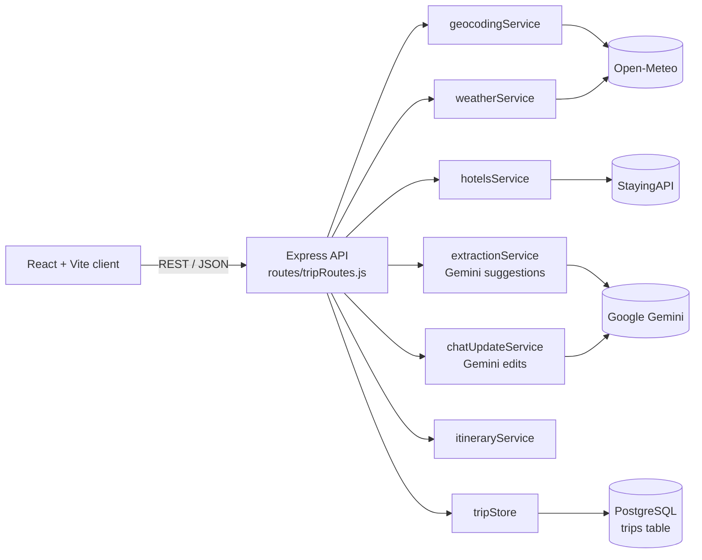

# AI Travel Planner

> A full-stack web app that turns a destination, dates and budget
> into a day-by-day itinerary with weather, hotels, AI-suggested activities and a live budget tracker.


## Table of Contents

- [Overview](#overview)
- [Features](#features)
- [Tech Stack](#tech-stack)
- [Architecture](#architecture)
- [Project Structure](#project-structure)
- [API Reference](#api-reference)
- [Known Limitations](#known-limitations)
- [Author](#author)
- [License](#license)

## Overview
The app allows users to select a destination, the number of travelers, travel dates, and a budget, and based on this information, it creates a comprehensive travel plan. 
The app provides recommendations for hotels, attractions, and restaurants along with their respective costs, a weather forecast for each day, and an overall estimate of the trip’s cost. 
The entire app isa bases on the use of free-tier APIs.

## Features
- Trip form: destination, travelers, date-range picker, budget
- 
- Day-by-day itinerary with weather forecast and icons per day
- AI-generated attractions, restaurants and local transport, with per-person price estimates
- Hotel suggestions (rating, nightly and total price, link)
- Budget tracker: per-day and trip totals, under/near/over-budget status
- Natural-language chat to edit the trip ("cheaper seafood restaurants every day", "something for the rainy day")
- Drag-and-drop reordering between days, plus item deletion
- Save, reopen and delete trips (PostgreSQL persistence)

## Tech Stack
| Layer | Technology |
|---|---|
| Frontend | React 19, Vite, @hello-pangea/dnd, react-day-picker |
| Backend | Node.js, Express 5 |
| Database | PostgreSQL (JSONB for itineraries) |
| AI | Google Gemini (`gemini-3.6-flash`) |
| External APIs | Open-Meteo (geocoding + weather), StayingAPI (hotels) |

## Architecture
System Diagram

Request flow for planning a trip:
1. Validate input: non-empty destination, valid ISO date range of a most 14 days, positive budget.
2. Geocode the destination(Open-Meteo).
3. Fetch the weather forecast(Open-Meteo). Non-critical: on failure, days are filled with null weather.
4. Fetch hotels (StayingAPI). Non-critical: on failure the list is empty.
5. Build the itinerary: one day per forecast date, with the top-rated hotels attatched.
6. Ask Gemini for daily attractions, restaurants and transport costs. Non-critical: on failure, days keep empty lists.
7. Save to PostgreSQL and return the JSON.

## Project Structure

```
ai-travel-planner/
├── backend/
│   ├── server.js                  # Express app entry point, CORS + JSON middleware
│   ├── db.js                      # PostgreSQL connection pool (pg)
│   ├── dateRange.js               # Builds/validates the list of trip dates
│   ├── routes/
│   │   └── tripRoutes.js          # All /api/trips endpoints; orchestrates the services
│   ├── services/
│   │   ├── geocodingService.js    # Destination → coordinates (Open-Meteo)
│   │   ├── weatherService.js      # Daily forecast (Open-Meteo)
│   │   ├── hotelsService.js       # Hotel search (StayingAPI)
│   │   ├── extractionService.js   # Gemini: daily attractions/restaurants/prices
│   │   ├── chatUpdateService.js   # Gemini: natural-language itinerary edits + budget check
│   │   ├── itineraryService.js    # Assembles days, attaches hotel and suggestions
│   │   └── tripStore.js           # CRUD for the trips table
│   ├── scripts/
│   │   └── setupDb.js             # Creates the trips table
│   ├── .env.example               # Required environment variables (no secrets)
│   └── package.json
├── frontend/
│   ├── index.html
│   ├── vite.config.js
│   ├── src/
│   │   ├── main.jsx               # React entry point
│   │   ├── App.jsx                # Top-level state, tab navigation, view switching
│   │   ├── api.js                 # All fetch calls to the backend
│   │   ├── index.css              # Global styles and design tokens
│   │   ├── components/
│   │   │   ├── TripInputForm.jsx  # Destination/travelers/date-range/budget form
│   │   │   ├── ItineraryView.jsx  # Itinerary page; drag-and-drop, save/delete
│   │   │   ├── DayCard.jsx        # One day: weather, items, expenses
│   │   │   ├── HotelsSection.jsx  # Hotel suggestions container
│   │   │   ├── HotelsCard.jsx     # Single hotel card
│   │   │   ├── TripCostSummary.jsx# Total cost + budget progress bar
│   │   │   ├── ChatPanel.jsx      # Floating chat widget for AI edits
│   │   │   └── SavedTripsView.jsx # "My trips" list
│   │   ├── utils/
│   │   │   ├── dayCosts.js        # Per-day and trip cost/budget calculations
│   │   │   ├── formatDate.js      # ISO → DD/MM/YYYY
│   │   │   ├── ordinal.js         # 1 → "1st"
│   │   │   └── WeatherIcons.js    # Weather code → icon
│   │   └── assets/                # Icons and weather images
│   └── package.json
├── docs/                          # Screenshots, demo GIF, diagrams
├── .gitignore
└── README.md
```

## API Reference
| Method | Endpoint | Description |
|---|---|---|
| POST | /api/trips/plan | Create an itinerary |
| POST | /api/trips/:id/update | Chat-based itinerary update |
| POST | /api/trips/:id/save | Mark trip as saved |
| GET | /api/trips/saved | List saved trips |
| GET | /api/trips/:id | Get one trip |
| PUT | /api/trips/:id | Overwrite itinerary (drag-drop/delete) |
| DELETE | /api/trips/:id | Delete a trip |


## Known Limitations
- AI prices and place names are estimates, not verified or live
- Gemini calls have limits
- Weather forecast only reaches about 16 days ahead
- Trips capped at 14 days

## Author


Faidon Stavridis
- LinkedIn: [linkedin.com](https://www.linkedin.com/in/faidon-stavridis-39b605368/)
- Email: faidonstav12@gmail.com

## License 
This project is licensed under the [MIT License](LICENSE).
