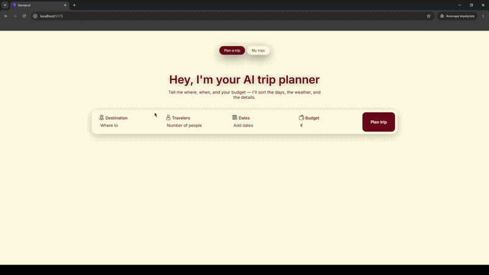
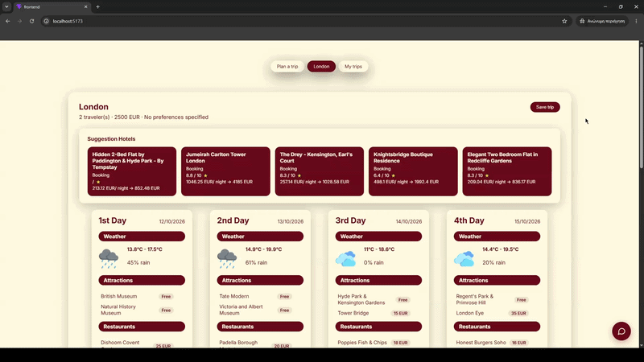
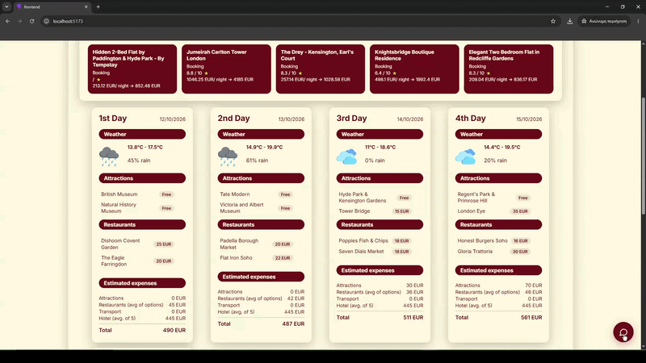
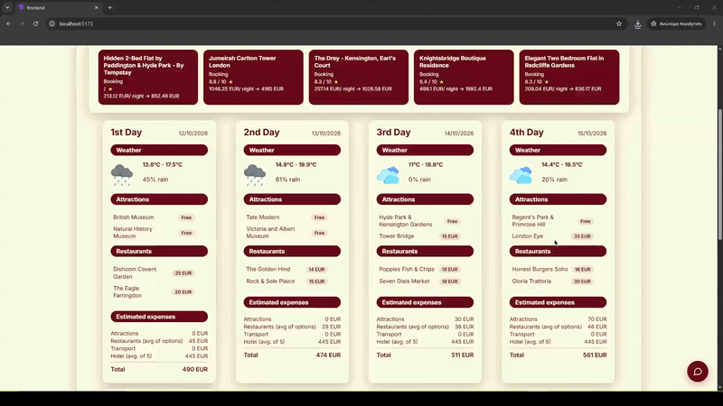
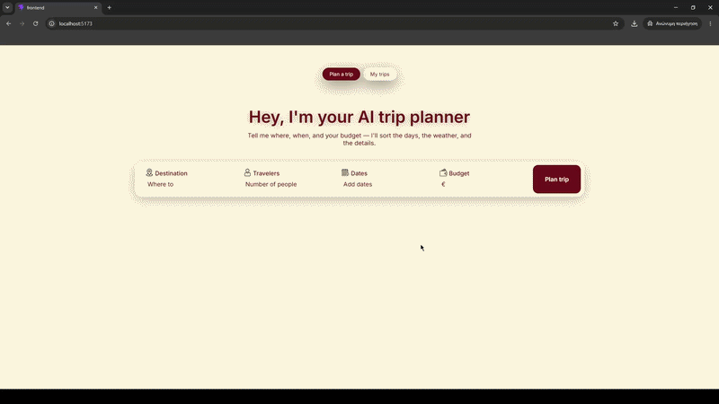
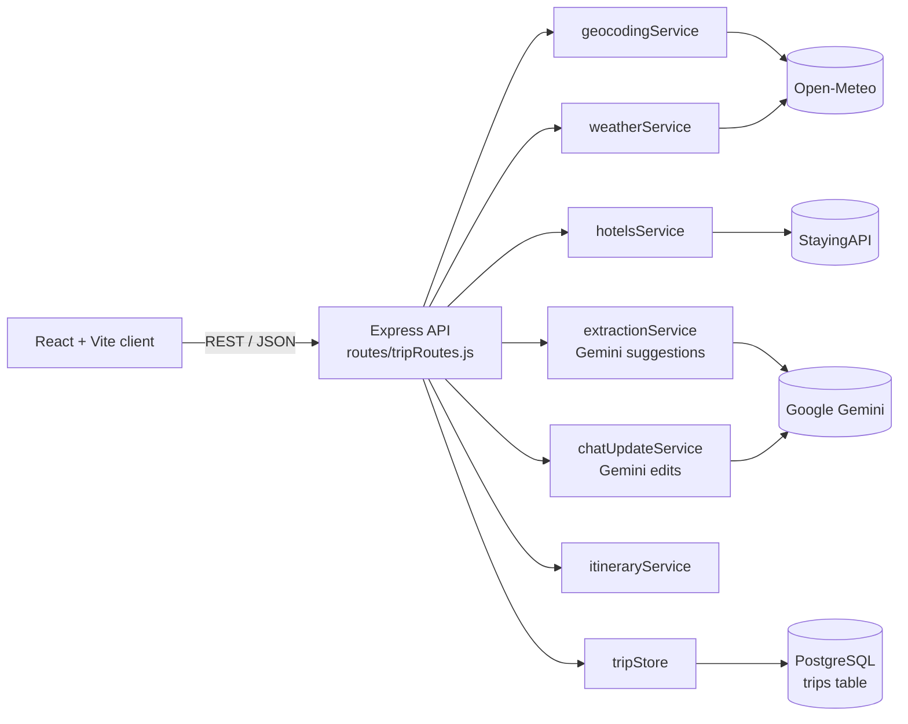

# AI Travel Planner

> A full-stack web app that turns a destination, dates and budget
> into a day-by-day itinerary with weather, hotels, AI-suggested activities and a live budget tracker.


## Table of Contents

- [Overview](#overview)
- [Features](#features)
- [Tech Stack](#tech-stack)
- [Architecture](#architecture)
- [Project Structure](#project-structure)
- [API Reference](#api-reference)
- [Known Limitations](#known-limitations)
- [Author](#author)
- [License](#license)

## Overview
The AI Travel Planner allows users to enter a destination, the number of travelers, travel dates, and a budget, and creates a complete travel itinerary based on this information.
The app provides recommendations for hotels, attractions, and restaurants with estimates cost, a daily weather forecast, and a total estimated cost of the trip. Users can modify, save, delete, and even upgrade their travel plan based on their interests. It has been developed entirely using free-tier APIs.


## Features
- **Plan a trip:** Enter a destination, number of travelers, date range and budget, then generate the plan.

  
  
- **Itinerary View:** The whole trip appears in one detailed view: a weather forecast for every day, hotel suggestions with details, AI-generated attractions, restaurants and local transport with per-person price estiamtes, and a budget tracker for each day and for the full trip.

  
  
- **Update Suggestions via chat:** Edit the trip in natural language ("cheaper seafood restaurants for day 2").
  
  
  
- **Modify suggestions manually:** Drag-and-drop items between days, or delete them.
  
  
  
- **Trips list:** Save, reopen and delete trips (PostgreSQL persistence).
  
  

## Tech Stack
| Layer | Technology |
|---|---|
| Frontend | React 19, Vite, @hello-pangea/dnd, react-day-picker |
| Backend | Node.js, Express 5 |
| Database | PostgreSQL (JSONB for itineraries) |
| AI | Google Gemini (`gemini-3.6-flash`) |
| External APIs | Open-Meteo (geocoding + weather), StayingAPI (hotels) |

## Architecture

### System Diagram



### Request flow for planning a trip

1. Validate the input: non-empty destination, valid ISO date range of a most 14 days, positive budget.
2. Geocode the destination (Open-Meteo).
3. Fetch the weather forecast (Open-Meteo). *Non-critical:* on failure, days are filled with null weather.
4. Fetch hotels (StayingAPI). *Non-critical:* on failure, the list is empty.
5. Build the itinerary: one day per forecast date, with the top-rated hotels attached.
6. Ask Gemini for daily attractions, restaurants and transport costs. *Non-critical:* on failure, days keep empty lists.
7. Save the trip to PostgreSQL and return it as JSON.

## Project Structure

```
ai-travel-planner/
├── backend/
│   ├── server.js                  # Express app entry point, CORS + JSON middleware
│   ├── db.js                      # PostgreSQL connection pool (pg)
│   ├── dateRange.js               # Builds/validates the list of trip dates
|   ├── package-lock.json
|   ├── package.json 
|   ├── .env
|   ├── .gitignore
|   ├── node_modules  
│   ├── routes/
│   │   └── tripRoutes.js          # All /api/trips endpoints; orchestrates the services
│   ├── services/
│   │   ├── geocodingService.js    # Destination → coordinates (Open-Meteo)
│   │   ├── weatherService.js      # Daily forecast (Open-Meteo)
│   │   ├── hotelsService.js       # Hotel search (StayingAPI)
│   │   ├── extractionService.js   # Gemini: daily attractions/restaurants/prices
|   |   ├── geminiClient.js        # Connection with gemini API KEY
│   │   ├── chatUpdateService.js   # Gemini: natural-language itinerary edits + budget check
│   │   ├── itineraryService.js    # Assembles days, attaches hotel and suggestions
│   │   └── tripStore.js           # CRUD for the trips table
│   ├── scripts/
│   │   └── setupDb.js             # Creates the trips table
├── frontend/
│   ├── index.html
│   ├── vite.config.js
|   ├── eslint.config.js
|   ├── package-lock.json
|   ├── package.json
|   ├── .gitignore
|   ├── node_modules
│   ├── src/
│   │   ├── main.jsx               # React entry point
│   │   ├── App.jsx                # Top-level state, tab navigation, view switching
│   │   ├── api.js                 # All fetch calls to the backend
│   │   ├── index.css              # Global styles and design tokens
│   │   ├── components/
│   │   │   ├── TripInputForm.jsx  # Destination/travelers/date-range/budget form
│   │   │   ├── ItineraryView.jsx  # Itinerary page; drag-and-drop, save/delete
│   │   │   ├── DayCard.jsx        # One day: weather, items, expenses
│   │   │   ├── HotelsSection.jsx  # Hotel suggestions container
│   │   │   ├── HotelsCard.jsx     # Single hotel card
│   │   │   ├── TripCostSummary.jsx# Total cost + budget progress bar
│   │   │   ├── ChatPanel.jsx      # Floating chat widget for AI edits
│   │   │   └── SavedTripsView.jsx # "My trips" list
│   │   ├── utils/
│   │   │   ├── dayCosts.js        # Per-day and trip cost/budget calculations
│   │   │   ├── formatDate.js      # ISO → DD/MM/YYYY
│   │   │   ├── ordinal.js         # 1 → "1st"
│   │   │   └── WeatherIcons.js    # Weather code → icon
│   │   └── assets/                # Icons and weather images
├── docs/                          # Screenshots, demo GIF, diagrams
├── .gitignore
└── README.md
```

## API Reference
| Method | Endpoint | Description |
|---|---|---|
| POST | /api/trips/plan | Create an itinerary |
| POST | /api/trips/:id/update | Chat-based itinerary update |
| POST | /api/trips/:id/save | Mark trip as saved |
| GET | /api/trips/saved | List saved trips |
| GET | /api/trips/:id | Get one trip |
| PUT | /api/trips/:id | Overwrite itinerary (drag-drop/delete) |
| DELETE | /api/trips/:id | Delete a trip |


## Known Limitations
- AI-generated prices and place names are estimates, not verified or live
- The free Gemini tier has a small request quota; when it is exceeded, suggestions are left empty.
- The stayingAPI for hotels data, have limit for request calls.
- Weather forecast only reaches about 16 days ahead.
- Trips are capped at 14 days.
- There is no user authentication, so trips are not ties to individual users.

## Author

**Faidon Stavridis**

- LinkedIn: [Faidon Staviridis](https://www.linkedin.com/in/faidon-stavridis-39b605368/)

## License 

This project is licensed under the [MIT License](LICENSE).
